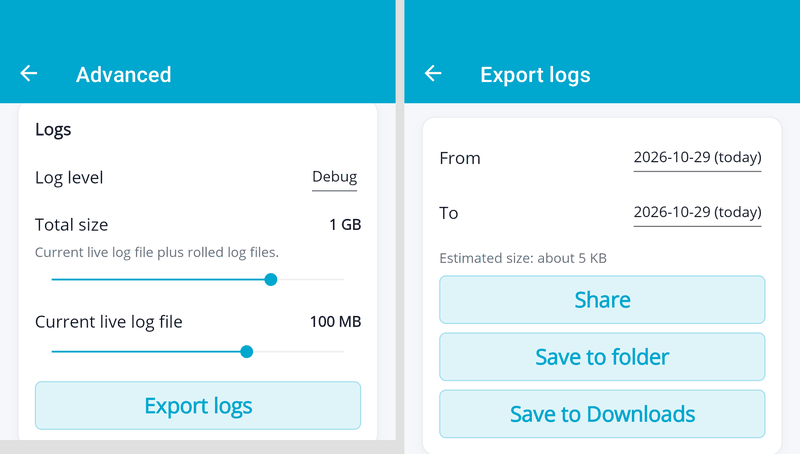
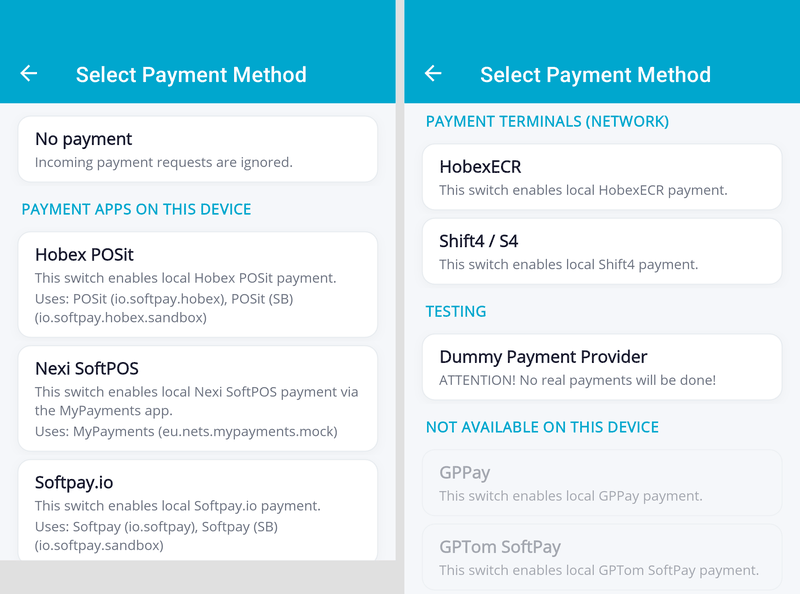

# InStore App 1.3.3

<!--truncate-->

## Log files on the device

The InStore App now writes its logs to files on the device, so that issues can be analyzed after they happened. Log files are kept for up to 31 days, compressed automatically, and personal data such as customer e-mail addresses and phone numbers, as well as secrets like API keys, are masked.

Under **Settings > Advanced > Logs** you can set the log level and the storage space used for logs, and **export** the logs of selected days as a ZIP file — to share it directly, save it to a folder, or save it to Downloads. Please attach this export when you contact our support about an issue.

_Affected issue(s):_ [#520](https://github.com/fiskaltrust/fiskaltrust-instore-app/issues/520)

---

## Only available payment providers can be selected

The payment provider selection in the settings now only lets you select providers that can actually work on the device:

- Providers that hand over to a payment app (Viva, Hobex POSit, Worldline / PayOne, Global Payments (GP tom, GP Pay), Softpay.io, Nexi, SumUp) can only be selected when their app (production or sandbox) is installed. Each entry shows which installed app will be used.
- The list is grouped into **Payment apps on this device**, **Payment terminals (network)** (Hobex ECR, Shift4) and **Testing**, with **No payment** on top. Providers whose app is not installed are listed at the bottom under **Not available on this device** and cannot be selected.
- If the selected payment app is uninstalled, the InStore App behaves like "No payment". The setting is kept and applies again as soon as the app is reinstalled.

_Affected issue(s):_ [#741](https://github.com/fiskaltrust/fiskaltrust-instore-app/issues/741)

---

## Details

### Features
- [Settings] Logs are written to files on the device and can be exported as a ZIP file under Settings > Advanced > Logs [#520](https://github.com/fiskaltrust/fiskaltrust-instore-app/issues/520)
- [eInvoicing] Preview of B2B invoicing for sandbox CashBoxes: after a receipt, the cashier can identify the business customer (VAT number lookup via VIES or manual entry) and send the invoice via PEPPOL or e-mail. It can be enabled under Settings > Advanced and is only visible when the app is paired with a sandbox CashBox [#802](https://github.com/fiskaltrust/fiskaltrust-instore-app/issues/802)
- [Payment] For payments started locally on the same device (e.g. via the fiskaltrust Android launcher), the InStore App now immediately reports when it does not accept a payment request, including the reason (e.g. not paired, no payment provider configured, action not supported), so the caller no longer has to wait for a timeout [#776](https://github.com/fiskaltrust/fiskaltrust-instore-app/issues/776)

### Improvements
- [Settings] Only payment providers that work on the device can be selected; the list is grouped by payment apps, network terminals and testing, with unavailable providers shown disabled at the bottom [#741](https://github.com/fiskaltrust/fiskaltrust-instore-app/issues/741)
- [Payment] A new payment request is refused while another payment is still running [#809](https://github.com/fiskaltrust/fiskaltrust-instore-app/issues/809)
- [Payment] Receipts that arrive during a payment are shown after the payment has finished, instead of interrupting the payment screen [#810](https://github.com/fiskaltrust/fiskaltrust-instore-app/issues/810)
- [Pairing] When pairing fails because the device date/time is wrong, a hint to check the date and time is shown instead of a misleading connection error [#813](https://github.com/fiskaltrust/fiskaltrust-instore-app/issues/813)
- [Receipt] When receipt actions (e.g. download, accept, sending by e-mail or SMS) fail because the device date/time is wrong, the receipt screen shows a hint to check the date and time [#814](https://github.com/fiskaltrust/fiskaltrust-instore-app/issues/814)
- [Receipt] Receipts are always shown and added to the receipt history, also when the device configuration could not be loaded from the cloud (default buttons are used then); when several receipts arrive in quick succession, the newest one is always shown on top [#823](https://github.com/fiskaltrust/fiskaltrust-instore-app/issues/823)
- [Receipt] The receipt history is ordered by receipt time, newest on top [#843](https://github.com/fiskaltrust/fiskaltrust-instore-app/issues/843)
- [Settings] Leading and trailing spaces are removed from entered values (e.g. API keys pasted from the clipboard) [#785](https://github.com/fiskaltrust/fiskaltrust-instore-app/issues/785)

### Bug fixes
- [Payment] A payment request that could not be accepted in time (e.g. because the app could not come to the foreground) was executed later, although the POS had already been told that the payment failed [#786](https://github.com/fiskaltrust/fiskaltrust-instore-app/issues/786)
- [Payment] A payment request whose acceptance could not be sent to the POS was never started, blocked other payments and could be executed late after an app restart [#821](https://github.com/fiskaltrust/fiskaltrust-instore-app/issues/821)
- [Payment] When the device clock was set back (e.g. corrected automatically), payment time limits were extended, so new payments could be refused and receipts held back [#822](https://github.com/fiskaltrust/fiskaltrust-instore-app/issues/822)
- [Payment] The payment progress screen was missing or flickered when the previous payment had finished while the app was in the background [#811](https://github.com/fiskaltrust/fiskaltrust-instore-app/issues/811)
- [App] In rare cases the InStore App moved itself to the background after a payment, although it had been in the foreground before [#789](https://github.com/fiskaltrust/fiskaltrust-instore-app/issues/789)
- [Receipt] The first receipt after a device restart was not shown and could not be accepted [#846](https://github.com/fiskaltrust/fiskaltrust-instore-app/issues/846)
- [Receipt] In consumer mode, the back button could close a receipt without accepting it, so the POS waited for the acceptance indefinitely; the back button is now disabled while the receipt can be confirmed with "OK" [#743](https://github.com/fiskaltrust/fiskaltrust-instore-app/issues/743)
- [Receipt] The receipt screen showed the receipt time in UTC instead of the device's local time [#842](https://github.com/fiskaltrust/fiskaltrust-instore-app/issues/842)
- [UI] On Android 15 and later, the soft keyboard covered the buttons of popups with a text field (Settings PIN, pairing, sending by e-mail or SMS) [#847](https://github.com/fiskaltrust/fiskaltrust-instore-app/issues/847)
